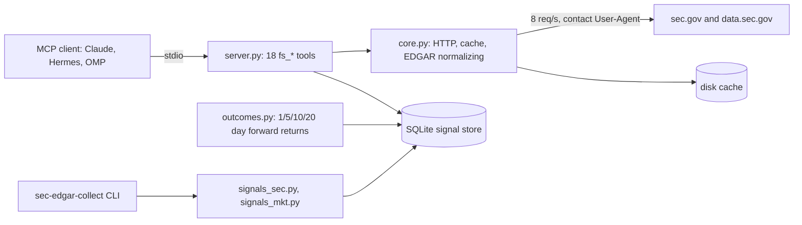

# kodros-sec-edgar-mcp

A read-only MCP server that gives an AI assistant numbers from SEC EDGAR filings. Every figure comes back with the filing it came from: accession number, form, filed date and XBRL tag.

Part of the [Kodros](https://kodros.ai) local AI stack.

## On your hardware

- Does: gives any MCP client numbers from SEC filings. The client decides which model it uses, local or not.
- Needs: Python 3.12 on any machine. No GPU. No language model sits in the data path.
- Network use: it reads public data over the internet from sec.gov and data.sec.gov. Price history uses Yahoo's unofficial chart endpoint, and prediction-market reads use public Polymarket and Kalshi APIs. The cache and the signal database stay on your disk.

## How it works



Static diagram: [docs/architecture.svg](docs/architecture.svg). Step-by-step build: [BUILD.md](BUILD.md).

`core.py` has no MCP imports, so it tests offline. The tools cover company lookup, reported XBRL series with restatements flagged, a fundamentals snapshot, side-by-side comparison of up to 8 companies, reading one Item of a filing, Form 4 insider trades, price history and a DCF calculator that fetches nothing. A collector sweeps the EDGAR daily index and grades each signal type against an equal-weight control. No language model sits in the data path. Missing data comes back as null, never zero.

## Stack

Python 3.12, FastMCP 3, httpx, defusedxml for filing XML, SQLite, uv, pytest.

## Run

```sh
uv sync
export SEC_EDGAR_USER_AGENT="my-app you@example.com"   # required by the SEC
uv run pytest
uv run sec-edgar-mcp                                     # stdio MCP server
uv run sec-edgar-collect sec --days 2                    # fill the signal store
uv run sec-edgar-collect outcomes                        # grade each signal kind against the control
```

MCP client config:

```json
{ "mcpServers": { "sec-edgar": {
  "command": "uv", "args": ["run", "--directory", "/path/to/kodros-sec-edgar-mcp", "sec-edgar-mcp"],
  "env": { "SEC_EDGAR_USER_AGENT": "my-app you@example.com" } } } }
```

Optional: `SEC_EDGAR_CACHE` (default `~/.cache/sec-edgar-mcp`) and `SEC_EDGAR_DB` (default `~/.local/share/sec-edgar-mcp/signals.db`).

## Status and limits

- Version 0.1.0. The offline test suite covers the math, signal scoring, XML entity rejection and outcome grading. Live smoke scripts in `tests/` need network.
- Requests to sec.gov are throttled to about 8 per second, under the SEC limit of 10.
- Price data uses Yahoo's unofficial chart endpoint, which can change without notice. Prediction market reads use public Polymarket and Kalshi APIs.
- The signal universe is today's liquid tickers, so backtests carry survivorship bias.
- No order, transfer or account tools. Output is research data, not investment advice.

## License

Copyright 2026 Tanner Osterkamp. All rights reserved. See [LICENSE](LICENSE). The source is public to read; ask before reuse.
